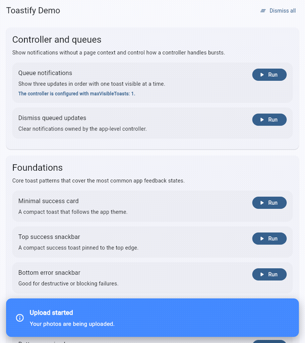

# my_toastify
[](https://pub.dev/packages/my_toastify) &nbsp;
[](https://github.com/tz-thantzin/my_toastify/blob/main/LICENSE) &nbsp;
[](https://buymeacoffee.com/devthantziq)

A beautiful, customizable **toast notification system** for Flutter.  
Supports banners, snackbars, custom icons, actions, and multiple stacking positions.

---


---
## 🚀 Features
- Overlay-based toast notifications
- Top or bottom stacking
- Three styles: **snackBar**, **banner**, and **minimal**
- Optional width + alignment controls for web and desktop layouts
- Custom icons, actions, and colors
- Auto-dismiss with animation
- Multiple toasts at once
- Swipe-to-dismiss gesture
- Customize toast animation
- Show and control toasts through an app-level host and controller
- Replace repeated notifications with deduplication keys
- Reuse shared colors, surfaces, corners, and shadows with `ToastifyThemeData`
- Announce toast updates with screen reader live regions
- Position toasts in screen corners or at the center

---

## 🎬 Animated examples

These GIFs show every demo in the [example app](example/README.md). Run the app to try the controls yourself.

### Minimal success card

Use `ToastStyle.minimal` for compact, theme-aware feedback.


### Top success snackbar

Set `ToastPosition.top` with `ToastStyle.snackBar` for a success message.


### Bottom error snackbar

Use `ToastType.error` at the bottom for failed actions.


### Top info banner

Combine `ToastType.info`, `ToastPosition.top`, and `ToastStyle.banner` for announcements.


### Bottom warning banner

Use `ToastType.warning` in a bottom banner for attention-worthy updates.


### Half-width bottom-right banner

Set `widthFactor: 0.5` and `horizontalAlignment: ToastHorizontalAlignment.end` on wide screens.


### Centered 60% banner

Set `widthFactor: 0.6` and `horizontalAlignment: ToastHorizontalAlignment.center`.


### Right-aligned snackbar with max width

Set `maxWidth: 420` and `horizontalAlignment: ToastHorizontalAlignment.end`.


### Countdown with pause

Set `showProgressBar: true`; hover or press and hold to pause the countdown.


### Custom leading icon

Pass a widget to `leading` to replace the default toast icon.


### Banner with action

Pass a button to `action` to let users respond from the toast.


### Border and shadow styling

Use `borderColor` and `boxShadow` to customize the toast surface.


### Persistent toast with cancel action

Set `isAutoDismissible: false` and dismiss the returned ID with `Toastify.dismissById`.


---

## 📦 Installation
```bash
$ flutter pub add my_toastify
```

---

## 🧠 Toast Options

### ToastDetails

| Property          | Type             | Default               | Description                              |
|-------------------|------------------|-----------------------|------------------------------------------|
| toastId           | String           | Unique ID generated   | Toast identifier for dismissing by ID    |
| message           | String           | —                     | Message text displayed in toast          |
| title             | String?          | null                  | Optional title above message             |
| type              | ToastType        | ToastType.info        | Defines color/icon scheme                |
| position          | ToastPosition    | ToastPosition.bottom  | Where toast appears                      |
| deduplicationKey  | String?          | null                  | Replaces an existing toast with the same key |
| theme             | ToastifyThemeData? | null                | Reusable toast colors, radius, and shadows |
| semanticLabel     | String?          | null                  | Accessible label for the toast           |
| announceToScreenReader | bool          | true                  | Announce toast as a live region update   |
| style             | ToastStyle       | ToastStyle.snackBar   | Toast UI layout, including `minimal`     |
| titleTextStyle    | TextStyle?       | textTheme.titleMedium | Custom title style                       |
| messageTextStyle  | TextStyle?       | textTheme.bodyMedium  | Custom message style                     |
| leading           | Widget?          | null                  | Optional icon widget                     |
| action            | Widget?          | null                  | Optional action button                   |
| backgroundColor   | Color?           | null                  | Override default color                   |
| borderColor       | Color?           | null                  | Adds custom border                       |
| boxShadow         | List<BoxShadow>? | null                  | Shadow customization                     |
| widthFactor       | double?          | null                  | Fraction of available width to occupy    |
| maxWidth          | double?          | null                  | Maximum toast width                      |
| horizontalAlignment | ToastHorizontalAlignment | stretch       | Horizontal placement within overlay      |
| duration          | Duration         | 3 seconds             | Auto dismiss time                        |
| showProgressBar   | bool             | false                 | Show a countdown bar for auto-dismiss     |
| pauseOnInteraction| bool             | true                  | Pause countdown on hover or long-press    |
| onDismiss         | VoidCallback?    | null                  | Callback when toast is dismissed         |
| isAutoDismissible | bool             | true                  | Set false to prevent automatic dismissal |
| animationDuration | Duration         | 500ms                 | Duration of entrance/exit animation      |
| appearCurve       | Curve            | Curves.easeOutBack    | Curve for show animation                 |
| dismissCurve      | Curve            | Curves.easeIn         | Curve for dismiss animation              |

### v2 notification features

Give repeated updates the same `deduplicationKey` to replace the visible
notification instead of stacking stale updates:

```dart
toastController.show(
  title: 'Syncing',
  message: '3 background tasks are running.',
  deduplicationKey: 'background-sync',
);
```

Set shared visual tokens on the controller, or pass a `theme` to one toast.
`ToastifyThemeData` supports type colors, minimal-style surface and foreground
colors, border radius, and shadows:

```dart
final toastTheme = ToastifyThemeData(
  successColor: const Color(0xFF286D65),
  surfaceColor: const Color(0xFFF0FAF7),
  foregroundColor: const Color(0xFF153D38),
  borderRadius: BorderRadius.circular(18),
);

final toastController = ToastifyController(theme: toastTheme);
```

To announce meaningful updates to assistive technology, supply a concise
`semanticLabel`. Live region announcements are enabled by default and can be
disabled for nonessential notifications. `ToastPosition` also includes
`topLeft`, `topRight`, `bottomLeft`, `bottomRight`, and `center` presets:

```dart
toastController.show(
  title: 'Payment received',
  message: 'Your receipt is ready to view.',
  semanticLabel: 'Payment received. Your receipt is ready to view.',
  position: ToastPosition.topRight,
);
```


---

## 💡 Example Usage

### App-level controller (v2.0)

Mount a `ToastifyHost` once in `MaterialApp.builder`, then show or dismiss
notifications through its controller without passing a page `BuildContext`:

```dart
final toastController = ToastifyController();

MaterialApp(
  builder: (context, child) => ToastifyHost(
    controller: toastController,
    child: child ?? const SizedBox.shrink(),
  ),
  home: const HomePage(),
);

// From callbacks or app services:
toastController.show(
  title: 'Saved',
  message: 'Your changes were saved.',
  type: ToastType.success,
);
```

By default, a controller shows up to three of its toasts at once and queues
additional notifications until a visible toast is dismissed. Configure the
limit and overflow behavior when creating the controller:

```dart
final toastController = ToastifyController(
  maxVisibleToasts: 1,
  queuePolicy: ToastQueuePolicy.replaceOldest,
);
```

`ToastQueuePolicy` supports `queue`, `dropNewest`, and `replaceOldest`. The
controller also provides `dismissById`, `dismissFirst`, `dismissLast`, and
`dismissAll`.

The [example app](example/README.md) includes a runnable queue demo and shows
the app-level host integration:



```dart
import 'package:flutter/material.dart';
import 'package:my_toastify/my_toastify.dart';

void main() {
  runApp(const ToastifyDemo());
}

class ToastifyDemo extends StatelessWidget {
  const ToastifyDemo({super.key});

  @override
  Widget build(BuildContext context) {
    return MaterialApp(
      home: Scaffold(
        appBar: AppBar(title: const Text('Toastify Example')),
        body: Center(
          child: ElevatedButton(
            onPressed: () {
              Toastify.show(
                context,
                title: 'Success',
                message: 'Profile updated successfully!',
                type: ToastType.success,
                position: ToastPosition.top,
                style: ToastStyle.banner,
              );
            },
            child: const Text('Show Toast'),
          ),
        ),
      ),
    );
  }
}
```

### ⏳ Countdown and pause

Show the remaining display time, and let users pause it by hovering (desktop/web)
or pressing and holding (touch):

```dart
Toastify.show(
  context,
  message: 'You can pause this countdown.',
  duration: const Duration(seconds: 5),
  showProgressBar: true,
);
```

### ✨ Minimal style

Use a compact card that follows the app's light or dark theme. The icon and
countdown use the toast type's accent color. The card defaults to a 420-pixel
maximum width; set `maxWidth` to change it.

```dart
Toastify.show(
  context,
  title: 'Saved',
  message: 'Your changes are ready.',
  type: ToastType.success,
  style: ToastStyle.minimal,
  showProgressBar: true,
);
```

---

## ⚙️ Advanced Usage Examples

### ✅ With Leading Icon

```dart
Toastify.show(
  context,
  title: 'Upload Complete',
  message: 'Your photo has been uploaded successfully.',
  type: ToastType.success,
  position: ToastPosition.bottom,
  style: ToastStyle.snackBar,
  leading: const Icon(Icons.check_circle, color: Colors.white),
);
```

---

### 🌫️ With Shadow

```dart
Toastify.show(
  context,
  title: 'File Saved',
  message: 'Document saved to local storage.',
  type: ToastType.success,
  position: ToastPosition.bottom,
  style: ToastStyle.snackBar,
  boxShadow: [
    BoxShadow(
      color: Colors.black.withOpacity(0.3),
      blurRadius: 10,
      offset: const Offset(0, 4),
    ),
  ],
);
```

---

### 🪄 With Action Button

```dart
Toastify.show(
  context,
  title: 'Undo Action',
  message: 'File deleted successfully.',
  type: ToastType.success,
  position: ToastPosition.bottom,
  style: ToastStyle.snackBar,
  action: TextButton(
    onPressed: () {
      debugPrint('Undo pressed');
    },
    child: const Text('Undo', style: TextStyle(color: Colors.white)),
  ),
);
```

---

### 💬 Without Title

```dart
Toastify.show(
  context,
  message: 'Settings have been updated.',
  type: ToastType.info,
  position: ToastPosition.bottom,
  style: ToastStyle.snackBar,
);
```

---

### 🔔 With onDismiss Callback

```dart
Toastify.show(
  context,
  title: 'Info',
  message: 'This toast will print when dismissed.',
  type: ToastType.info,
  onDismiss: () {
    debugPrint('Toast was dismissed!');
  },
);
```

---

### ⏹️ Non-Auto-Dismiss Toast with Action and dismissById

```dart
late final String toastId;
toastId = Toastify.show(
    context,
    title: 'Upload File',
    message: 'Uploading in progress...',
    type: ToastType.info,
    position: ToastPosition.bottom,
    style: ToastStyle.snackBar,
    isAutoDismissible: false,
    action: TextButton(
        onPressed: () {
            Toastify.dismissById(toastId);
            ScaffoldMessenger.of(context).showSnackBar(
              const SnackBar(content: Text("Upload canceled")),
            );
        },
        child: const Text('CANCEL', style: TextStyle(color: Colors.white)),
    ),
);
```

---

### 🌐 Half-width bottom-right banner on web

```dart
Toastify.show(
  context,
  title: 'Web Layout',
  message: 'Half-width banner pinned to the bottom-right on web.',
  type: ToastType.info,
  position: ToastPosition.bottom,
  style: ToastStyle.banner,
  widthFactor: kIsWeb ? 0.5 : null,
  horizontalAlignment: kIsWeb
      ? ToastHorizontalAlignment.end
      : ToastHorizontalAlignment.stretch,
);
```

---

### 🎞️ Animation Control Examples (v1.1.0)
### Smooth Fade Animation

```dart
Toastify.show(
    context,
    title: "Smooth Animation",
    message: "Custom fade-in and fade-out animation.",
    type: ToastType.success,
    appearCurve: Curves.easeOut,
    dismissCurve: Curves.easeIn,
    animationDuration: const Duration(milliseconds: 300),
);
```

### Bounce-In Entrance

```dart
Toastify.show(
    context,
    title: "Bounce In",
    message: "This toast uses a bounce entrance.",
    type: ToastType.info,
    appearCurve: Curves.bounceOut,
    dismissCurve: Curves.easeInExpo,
    animationDuration: const Duration(milliseconds: 450),
);
```

---
## ❤️ Author
Created by **Thant Zin**

* GitHub Home: [https://github.com/tz-thantzin](https://github.com/tz-thantzin)
* Repository: [https://github.com/tz-thantzin/my_toastify](https://github.com/tz-thantzin/my_toastify)

Copyright (©️) 2025 __Thant Zin__
