# Toastify example app

This example app is organized as a small catalog of copy-paste friendly toast scenarios.

Run it with `flutter run` from this directory, then select a demo to try its controls.

The catalog includes controller queues, deduplication, shared themes,
screen-reader announcements, and corner/center placement. The combined preview
shows these features in sequence:

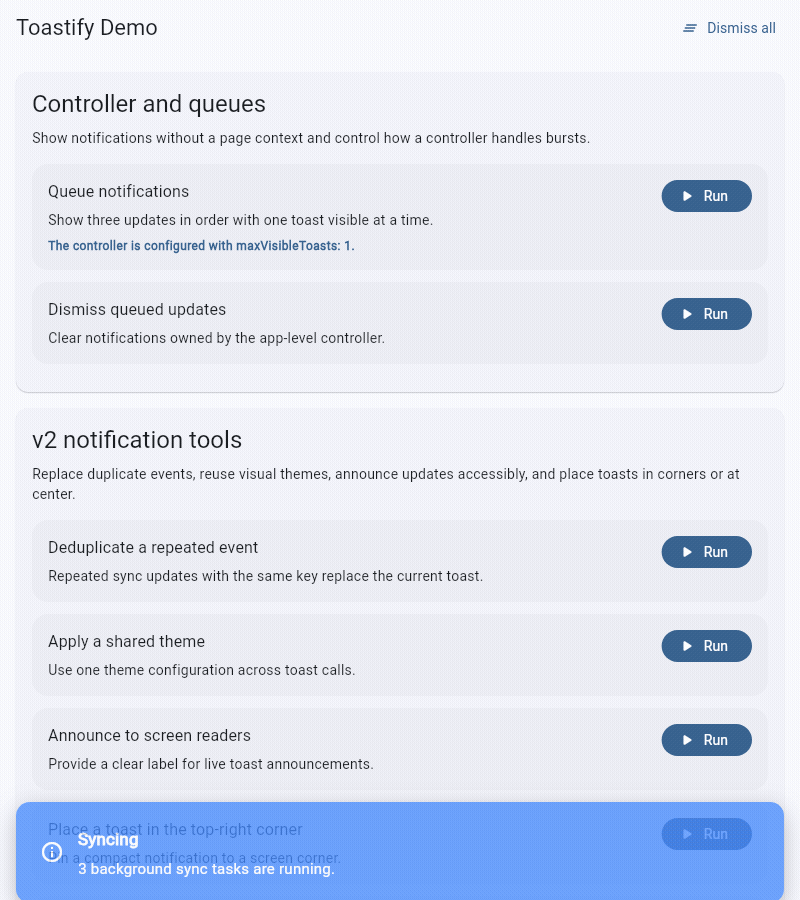

Run `flutter run -d chrome --web-port 5184` and open `/?demo=features` to replay
the preview sequence.

## Animated examples

### Minimal success card

Uses `ToastStyle.minimal` and a countdown bar.

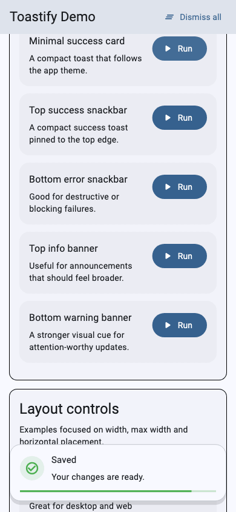

### Top success snackbar

Shows a success toast at the top of the screen.

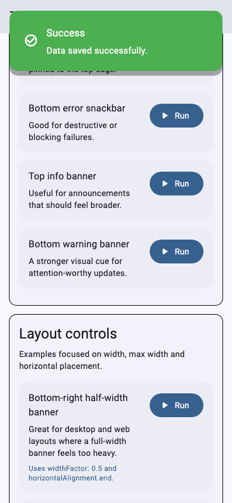

### Bottom error snackbar

Shows an error toast at the bottom of the screen.

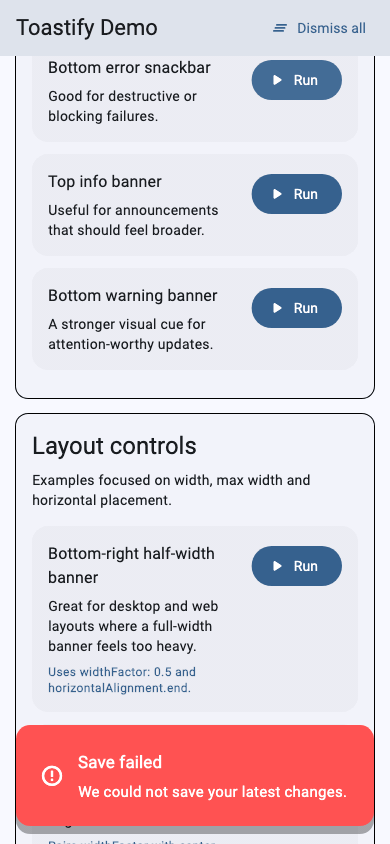

### Top info banner

Shows a full-width announcement banner at the top.

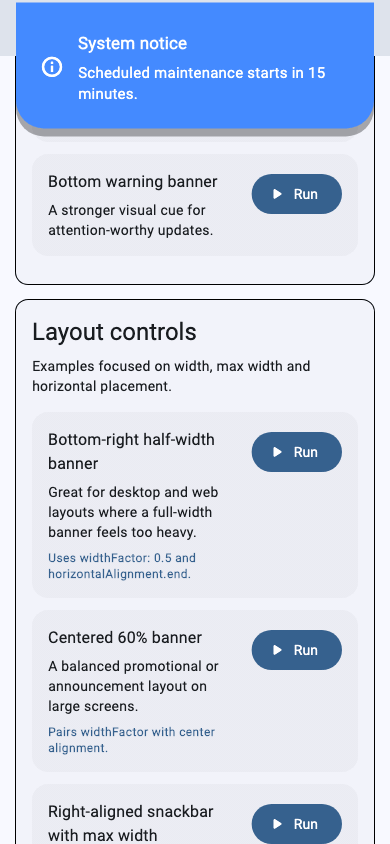

### Bottom warning banner

Shows a warning banner at the bottom.

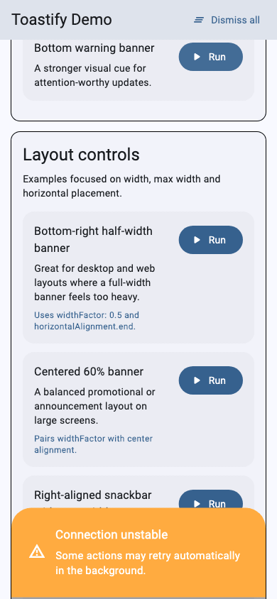

### Half-width bottom-right banner

Places a half-width banner at the bottom right on wide screens.

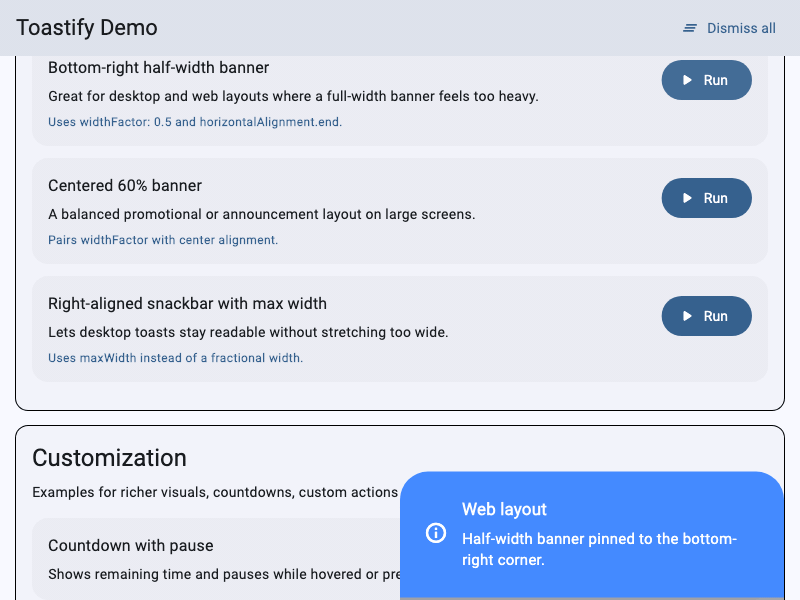

### Centered 60% banner

Centers a banner at 60% of the available width.

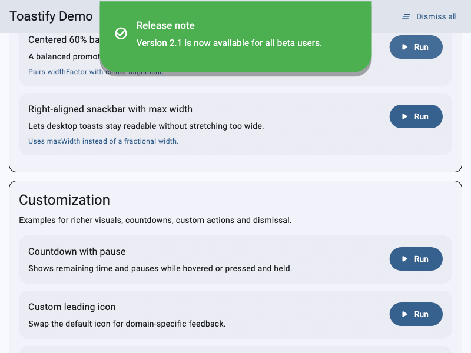

### Right-aligned snackbar with max width

Keeps the snackbar to a readable width on wide screens.

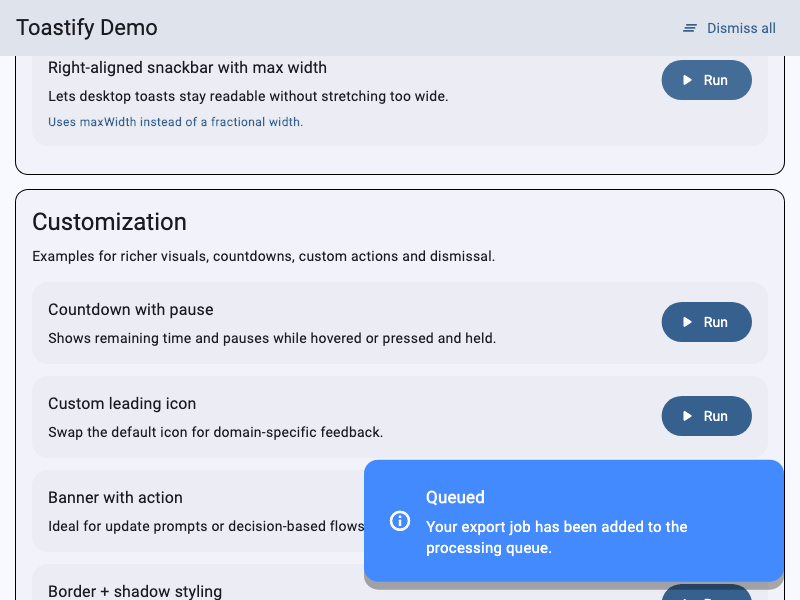

### Countdown with pause

Shows remaining time; hover or press and hold to pause it.

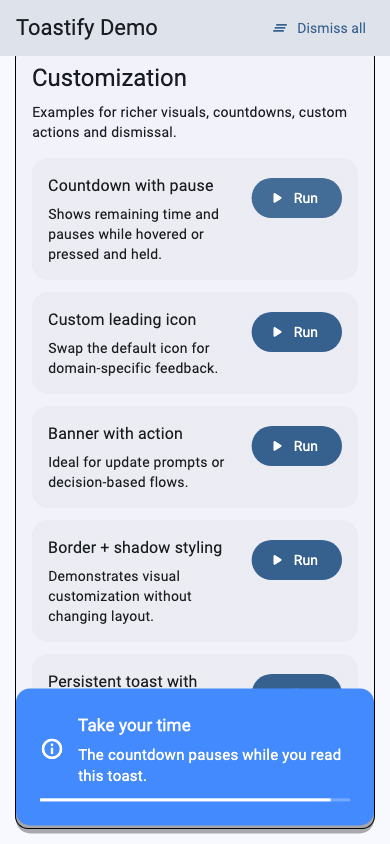

### Custom leading icon

Replaces the default icon with a download icon.

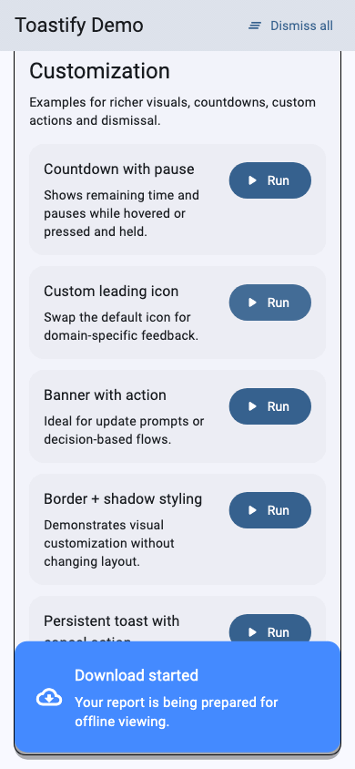

### Banner with action

Adds an UPDATE button to the banner.

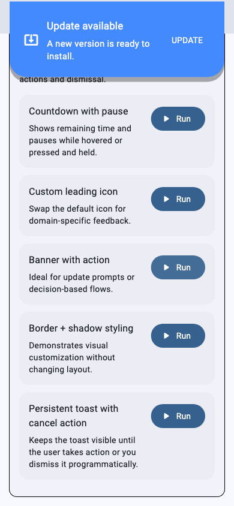

### Border and shadow styling

Adds a custom outline and shadow.

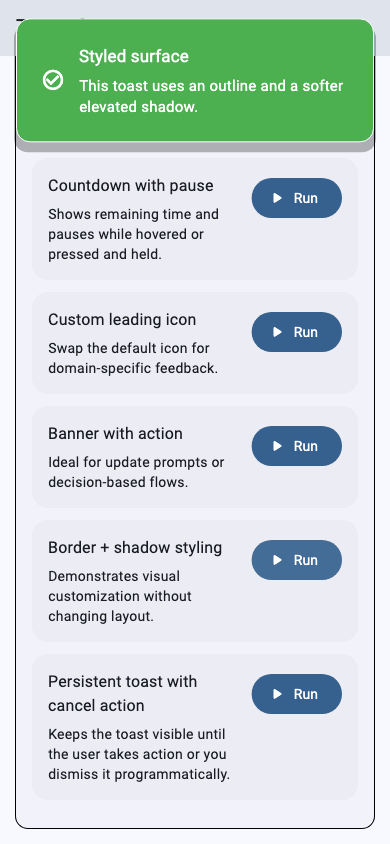

### Persistent toast with cancel action

Keeps the toast visible until its CANCEL action dismisses it.

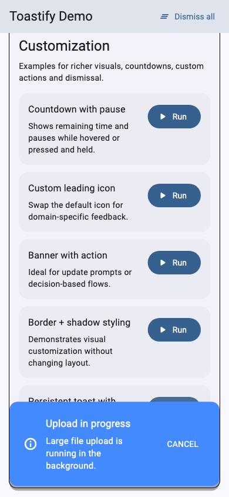

## File structure

- `lib/main.dart` – demo shell and sectioned UI
- `lib/examples/basic_examples.dart` – baseline snackbar and banner patterns
- `lib/examples/layout_examples.dart` – width/alignment examples including bottom-right half-width web usage
- `lib/examples/customization_examples.dart` – leading widgets, actions, border/shadow and persistent toasts
- `lib/examples/queue_examples.dart` – app-level controller and queued notification examples
- `lib/examples/demo_catalog.dart` – shared demo models used by the catalog UI

## Why this layout

The example code is split by concern so package users can quickly lift only the scenario they need instead of scanning one very long `main.dart` file.
